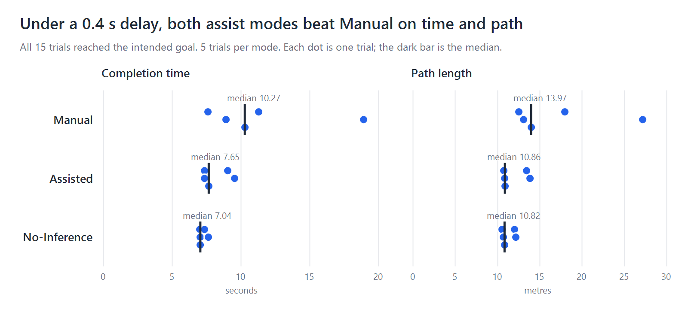

# Policy Blending for Shared Control in Webots

A simplified adaptation of policy-blending shared control (Dragan & Srinivasa, 2013) on a simulated Clearpath Moose robot. As you drive, the robot estimates which of three goals you want and blends its own steering with your keyboard commands.

This is a small simulation-based adaptation, not a reproduction of the original study.

## Pilot results

15 trials under a 0.4 s command delay, 5 per mode, driven by one operator who built the system. All trials reached the intended goal.

| Mode | Median time (s) | Median path (m) | Collisions |
| --- | --- | --- | --- |
| Manual | 10.27 | 13.97 | 2 |
| Assisted | 7.65 | 10.86 | 0 |
| No-Inference | 7.04 | 10.82 | 3 |

These are descriptive results from a small pilot, not proof of a general effect. Raw data is in `trials.csv`.

## Run it

1. Install [Webots R2025a](https://cyberbotics.com/).
2. Open `worlds/shared_control_moose.wbt`.
3. Open `controllers/moose_path_following/moose_path_following.c` in the Webots editor and click **Build**.
4. Click the 3D view, then:
   - Press **M** (Manual), **S** (Assisted) or **N** (No-Inference).
   - Wait a second, then press **1**, **2** or **3** to declare your goal.
   - Drive with the arrow keys until `TRIAL DONE` appears.
5. Press the rewind button before the next trial.

Each completed trial adds a row to `trials.csv`. Don't save the world after driving, or the robot's start position will change.

## Files

- `worlds/shared_control_moose.wbt`: the course, with goal posts and obstacles
- `controllers/moose_path_following/moose_path_following.c`: goal inference, blending, 0.4 s delay, collision count and logging
- `trials.csv`: the 15 pilot trials
- `results/`: the results chart and diagrams

## Reference

A. D. Dragan and S. S. Srinivasa, "A Policy-Blending Formalism for Shared Control," *International Journal of Robotics Research*, 32(7), 790-805, 2013. https://doi.org/10.1177/0278364913490324
